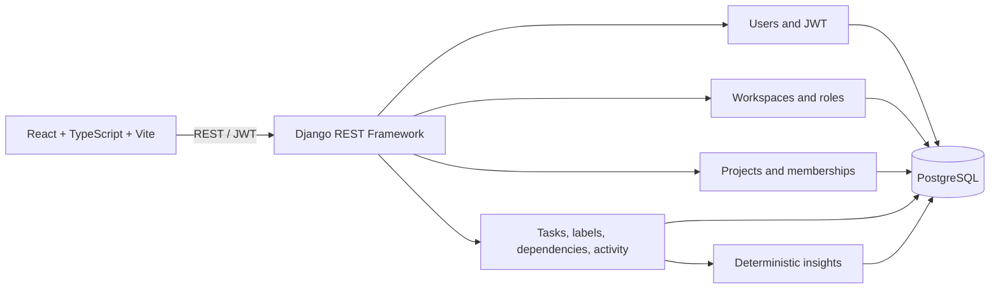

# DevFlow

DevFlow is a lightweight project tracker for small software teams. Its main differentiator is a deterministic workflow-intelligence layer: task dependencies are used to identify blockers, bottlenecks, overdue work, and project risk, with evidence shown for findings. Risk levels are heuristics, not predictions, and workload counts are not productivity measures.

## MVP status

Authentication, workspaces, projects, tasks, a Kanban board, dependency APIs, workflow-insight APIs, an insights panel, and backend tests are implemented. The five seeded evaluation scenarios currently pass. Docker Compose and CI configuration are included. A hosted demo, measured 500-task p95 latency, and screenshots are not yet available; see [known limitations](#known-limitations).

## Features

- Email-based registration and JWT authentication.
- Workspace membership with Owner, Admin, and Developer roles.
- Project membership with Manager and Member roles.
- Tasks with status, priority, assignment, due date, estimate, labels, and completion timestamp.
- Finish-to-Start task dependencies with same-project, self-link, and cycle validation.
- Blocked-task indicators and a warning when moving a blocked task to In Progress.
- Deterministic downstream impact, bottleneck, stale-blocker, critical-path, overdue, workload, health, and recommendation calculations.
- Evidence for workflow findings, including task IDs, counts, and dates.

## Architecture



Backend apps live in `backend/users`, `backend/workspaces`, `backend/projects`, and `backend/tasks`. The frontend is under `frontend/src`.

## Run locally with Docker Compose

1. Copy `.env.example` to `.env` and replace `DJANGO_SECRET_KEY` with a local random value.
2. Start the app from the repository root:

   ```powershell
   docker compose up --build
   ```

3. Open [http://localhost:8080](http://localhost:8080).

The backend applies migrations when its container starts. PostgreSQL data is stored in the `postgres_data` Docker volume.

To seed a demo account, set `DEMO_USER_EMAIL`, `DEMO_USER_PASSWORD`, and optionally `DEMO_USER_NAME` in the root `.env` file, then run:

```powershell
docker compose exec backend python manage.py seed_demo
```

The command does not print the password. Do not use demo credentials or the local `.env` values for a public deployment.

## Run components without Docker

### Backend

Use Python 3.12 and PostgreSQL. Install backend dependencies, set the environment variables shown in `.env.example`, then run:

```powershell
cd backend
..\venv\Scripts\python.exe -m pip install -r requirements-dev.txt
..\venv\Scripts\python.exe manage.py migrate
..\venv\Scripts\python.exe manage.py runserver
```

### Frontend

```powershell
cd frontend
npm ci
npm run dev
```

For a separate Vite frontend, set `VITE_API_BASE_URL` to the backend API base, such as `http://localhost:8000/api/v1`.

## Tests and evaluation

Run backend tests from the `backend` directory with a configured PostgreSQL database:

```powershell
..\venv\Scripts\python.exe -m pytest
```

Build and lint the frontend from `frontend`:

```powershell
npm run lint
npm run build
```

The expected outcomes and results for the five initial seeded intelligence scenarios are recorded in [docs/INTELLIGENCE_EVALUATION.md](docs/INTELLIGENCE_EVALUATION.md). The 1,000-task chain test checks graph correctness and avoids recursion-depth failures. It is not a performance benchmark.

## Design decisions

See [DECISIONS.md](DECISIONS.md) for dependency direction, blocked-task behavior, graph algorithms, health thresholds, and deletion constraints.

## Known limitations

- No live deployment or public demo credentials have been configured.
- The required insight latency target (p95 under 500 ms for 500 tasks and 300 dependencies) has not been measured.
- The initial five hand-authored scenarios are not enough to estimate general accuracy or false-positive/false-negative rates.
- The dependency graph supports Finish-to-Start only.
- Project health is heuristic and depends on task statuses and dates being kept current.
- Workload counts describe assigned open tasks only; they do not measure productivity or effort.
- No screenshots or demo recording are included yet.

## Security notes

Secrets are read from environment variables. `.env` files are ignored by Git and excluded from the backend Docker build context. Use a unique secret key and strong database password outside local development.
